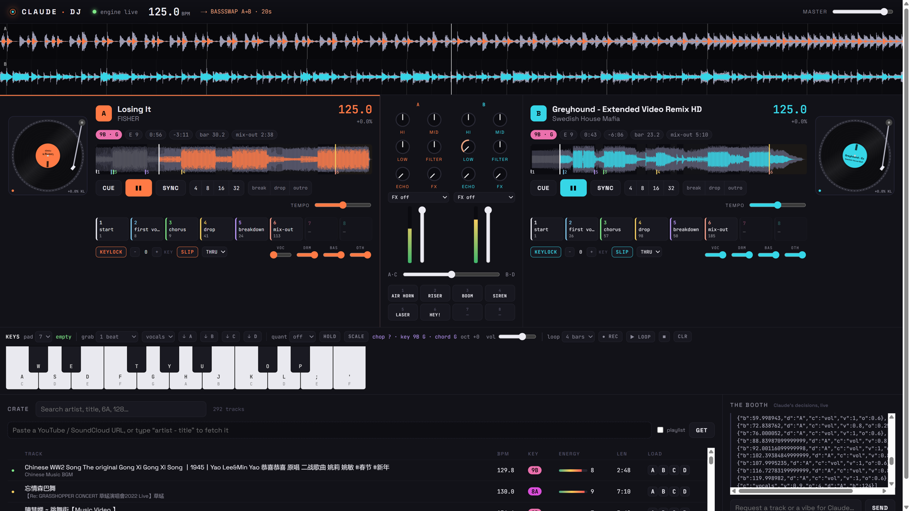
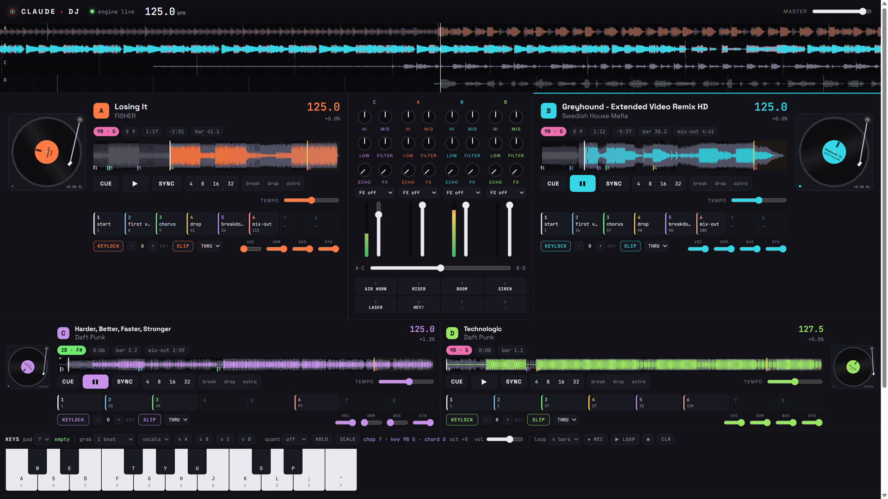

# Claude DJ 🎧

A DJ rig that **Claude Code plays**. You direct the set in plain text ("play Sandstorm next", "kill the bass", "harder",
"mix into something darker"); Claude reads the crate, picks tracks, times the mixes on the beat and talks to the booth.
The browser tab is the sound system and the visuals.

```
you (typing in Claude Code) ──► Claude + DJ skills ──► node dj.mjs … ──► server ──► browser audio engine ──► speakers
                                                                 ▲                         │
                                                crowd requests from the booth ◄────────────┘
```



**See it in action:** an hour-long set recorded live on the rig, speech clips as the vocals, DJ-table footage as B-roll.

[](https://youtu.be/fjGADpEmGJs)

Everything runs locally: a Node server, a Web Audio engine in your browser, ffmpeg for analysis, yt-dlp for the crate.
No npm dependencies.

## Quick start
Requirements: **Node 20+**, **ffmpeg + ffprobe** on PATH, a Chromium-based browser, and [Claude Code](https://claude.com/claude-code).

```bash
git clone <this repo> claude-dj && cd claude-dj
node dj.mjs doctor --fix     # checks ffmpeg/node, downloads yt-dlp into bin/
node dj.mjs start            # starts the server and opens http://localhost:4747
```
Click **Start engine** in the tab once (browsers need one click before they may play audio). Drop some music into
`library/` (or let Claude download it), then open Claude Code in this folder and talk to it:

- `play a 30 minute house set that builds to a peak`
- `get me Darude - Sandstorm and Headhunterz - Dragonborn`
- `mix into Sandstorm on the next phrase` · `kill the bass… bring it back on the drop`
- `harder` · `chill it out` · `loop this` · `wrap it up in 10 minutes`
- `record this and make me a video of the set`

People in the room can type requests into the **booth** box in the browser; Claude sees them as crowd requests.

## How it works
| Piece | What it does |
|---|---|
| `server.mjs` | Holds the library and analysis cache, relays commands to the browser engine, long-polls (`dj wait`), booth log, crowd inbox, recorder, auto-DJ. |
| `dj.mjs` + `cli-ext/` | The CLI Claude drives: `node dj.mjs help` and `node dj.mjs help-engine`. |
| `public/engine.js`, `public/worklets/` | Web Audio engine: four decks (A/B + C/D), 3-band kill EQ, filter, beat-synced echo, loops, key lock + key shift (WSOLA), per-stem playback, deck FX, 8-pad sampler, scratching, sample-accurate transitions. |
| `public/app.js` | The DJ-table UI and the booth feed. |
| `lib/analyze.mjs` | BPM and beat grid, downbeat, key (Camelot), loudness, energy 1–10, intro/breakdowns/drops/outro, section labels, auto hot cues. |
| `lib/library.mjs` | Cache, search, harmonic/tempo/energy suggestions, mashup pairing. |
| `lib/downloader.mjs` | yt-dlp wrapper: search, download, playlist caps; uses `.dj/youtube-cookies.txt` if you provide one. |
| `lib/sequencer.mjs`, `lib/monitor.mjs`, `lib/memory.mjs` | Scheduled plan steps and track queue, auto-DJ safety net, mix monitor with transition critiques, set memory + ratings. |
| `lib/stems.mjs` + `lib/separate.py` | Optional stem separation (demucs) so vocals/drums/bass can be muted or swapped live. |
| `produce/` | Production toolchain: Playwright page recording, set/album video rendering, caption indexing for speech clips, voice-reel builder, live design runner, per-track cutting, speaker footage cut-ins (`video-cuts.mjs`), deck screenshots (`snap-deck.mjs`). |



### Skills (`.claude/skills/`)
These are what make Claude a DJ rather than a chatbot with a CLI. Claude Code loads them automatically in this folder.

| Skill | Use |
|---|---|
| `dj` | Front door: boot, status, turn any text direction into deck/mixer commands. Full CLI reference. |
| `dj-set` | Autopilot set with an energy arc, harmonic track selection and phrase-timed mixes. Steerable at any moment. |
| `dj-mix` | Transition craft: style, length, timing, entry point (intro / drop), knob choreography. |
| `dj-crate` | Find and download music (extended mixes preferred), search by BPM/key/energy, trust the analysis. |
| `dj-video` | Record the DJ table page while a set plays and render a music video of the exported set. |
| `dj-mashup` | Live mashups with stems: pairing rules, key/tempo fit, vocal placement, loop-roll into the drop. |
| `dj-voice` | Speech clips as the vocals: caption index, exact lines and phrases, a beat-locked voice reel played live. |
| `dj-album` | A themed album as one live take: beds per track, one planning subagent per song, per-track masters and videos. |
| `dj-troubleshoot` | Symptom → fix table for the rig (engine stale, silent deck, stuck loop, disk, stems load, YouTube wall). |

`CLAUDE.md` tells Claude how the folder is wired and how to behave during a live set (short waits, the user's latest words win).

## Transitions and timing
Transitions are scheduled on the audio clock, so they land on the beat even with the tab in the background:
`blend` (EQ blend + bass swap) · `bassswap` · `double` · `fade` · `filter` · `echo` · `cut` · `brake` · `spinback`, started
`--at now|bar|phrase`, with the incoming track entering at its `mixin`, `intro` or `drop`. `dj perform` schedules knob
choreography per beat; `dj plan add` schedules any command for a future bar, mix-out point or wall-clock time.

The **auto-DJ** steps in only if the live track is 45 s from its end with nothing planned. The **mix monitor** flags vocal
clashes, key clashes, beat-phase offsets, tempo mismatch and clipping, and critiques every transition in the booth.

## Making a video of a set
```bash
node produce/record-browser.mjs                 # before the set: records the DJ table page (Playwright), becomes the sound system
node dj.mjs record start --no-screen --no-mic   # … play the set …
node dj.mjs record stop && node dj.mjs export   # → .dj/exports/<session>.mp3 + tracklist
node produce/record-browser.mjs --stop
node produce/make-video.mjs .dj/exports/<session>.mp3 --title "DJ Claude - Friday Lunch Set" --screen auto
```
You get a 720p mp4 and a 480p copy: reactive visualiser, title card, the DJ table as footage, one colour tint per track.
Details and options in `.claude/skills/dj-video/SKILL.md`.

## Speech clips as the vocals, and albums
The sample video above is an hour-long album made this way: talk clips indexed from their captions
(`produce/index-captions.mjs`), a title hook per track cut word-accurately, verses that literally match the song's
words, one subagent planning each song, a voice reel built with `produce/build-reel.mjs`, the whole thing played as one
live take by `produce/run-design.mjs` and cut into tracks with `produce/cut-track.mjs`. The `dj-voice` and `dj-album`
skills walk through it; `produce/songs/README.md` is the song-plan schema.

## Stems (vocals / drums / bass / other)
Optional, CPU-only, project-local. Every track can be split into `.dj/stems/<trackId>/{vocals,drums,bass,other}.wav`
by demucs (`htdemucs`) in the background at idle priority; the vocal stem also gives each track a vocal map that the
mixer uses to avoid vocal clashes. Install into `.venv` (no system changes):
```bash
uv venv .venv --python 3.12
uv pip install torch --index-url https://download.pytorch.org/whl/cpu numpy
uv pip install --no-deps demucs dora-search einops julius pyyaml tqdm omegaconf retrying submitit treetable
```
`lib/separate.py` decodes with ffmpeg and writes WAVs itself, so it also works where torchaudio has no wheel (Windows on
ARM). Model weights download to `.dj/models/` on first run. Control: `config.json → stems` (`enabled`, `auto`,
`concurrency`, `threads`), `dj stems <id|all>`, `dj stems status`, `dj vocals <id>`. While music plays, separation
throttles to one job.

## Configuration and data
`config.json`: port, `libraryDirs` (default `./library` and `~/Music`), download folder, loudness target, stems, auto-DJ.

Everything the rig generates lives in `.dj/` (git-ignored): `library.json` analysis cache, `pcm/` decoded audio cache
(safe to delete), `stems/`, `sessions/` and `exports/` (recordings, mp3 + tracklist + cue), `memory.json`, `cues.json`,
`grid-edits.json`, `server.log`. Music lives in `library/` (git-ignored).

YouTube sometimes asks for a login. Export your cookies to `.dj/youtube-cookies.txt` (Netscape format) and both
`dj get` and `produce/get-sample.mjs` will use them. Never commit that file.

## Tests
```bash
node --test test/*.test.mjs test/server-*.mjs
```
Server tests run scratch copies on ports 4851–4856 with a fake engine and never touch `.dj/`.

## Notes
- Built for personal use with music you have the rights to play. Downloads are your responsibility.
- Windows is the primary platform (PowerShell/Git Bash); the engine and server are plain Node + browser and run elsewhere, but
  paths such as fonts in `produce/viz.mjs` default to Windows and may need `VIZ_FONT_BOLD`.
